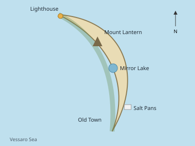
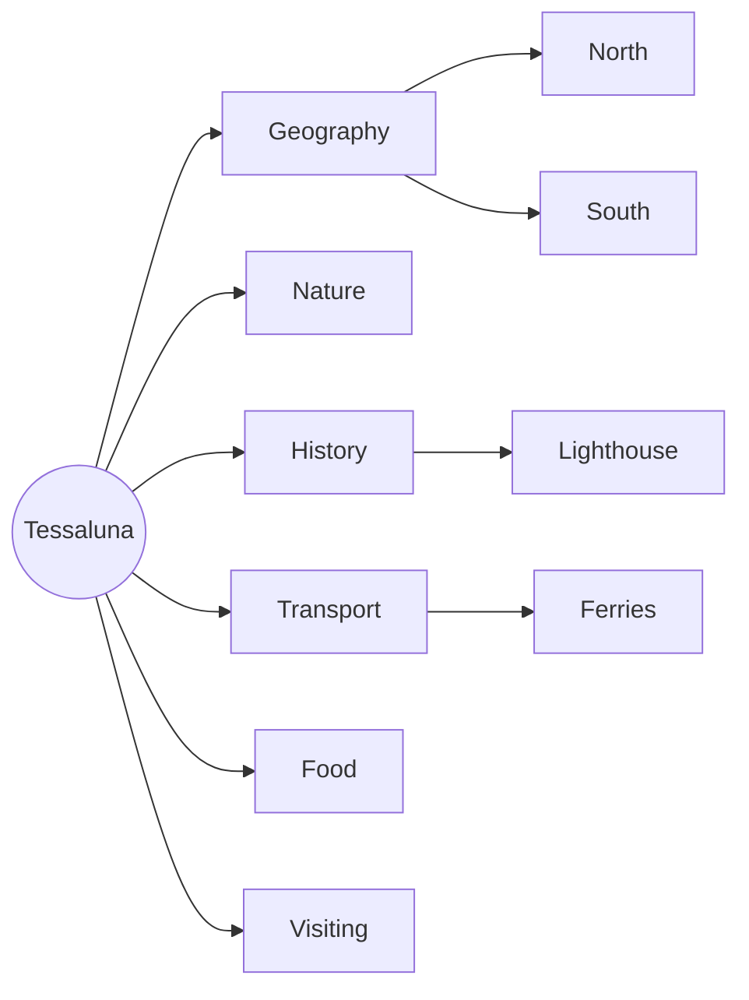

# Tessaluna

> Demo content for testing. Tessaluna and everything described in this wiki are fictional.

Tessaluna is a crescent-shaped island in the middle of the equally imaginary Vessaro Sea.
This wiki covers its geography, nature, history, transport, food and a few practical notes for
visitors.

## Sections

| Section | What you will find |
|---|---|
| [Geography](geography/README.md) | Regions, villages, coasts and climate |
| [Nature](nature/README.md) | Plants and animals of the island |
| [History](history/README.md) | Timeline, the lighthouse, legends |
| [Transport](transport/README.md) | Ferries, trails and timetables |
| [Food](food/README.md) | Local dishes and recipes |
| [Visiting](visiting/README.md) | A day on the island, open data |
| [Documents](documents/README.md) | Harbour rules, presentations, flyers |

## Good places to start

- [[overview]], the island on one page
- [[lighthouse|The Long Point Lighthouse]], the symbol of the island
- [[lantern night]], the most important festival
- [[ferries]], how to get here

