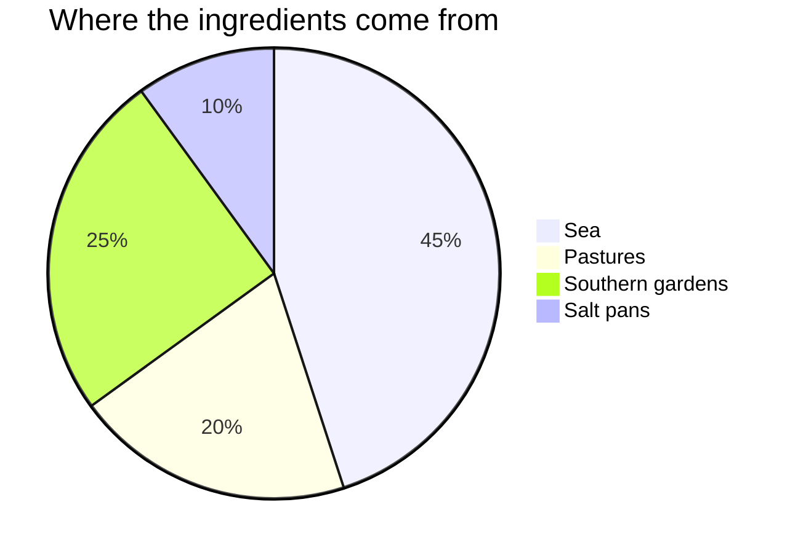

# Ingredients

| Ingredient | Comes from | Used in |
|---|---|---|
| Salt | Eastern Salt Pans | all the [[recipes]] |
| Sheep's cheese | [[highfold]] | lighthouse bread |
| Mixed fish | North Harbour | Spinner soup |
| Sweet bramble | along the trails | bramble tart |

