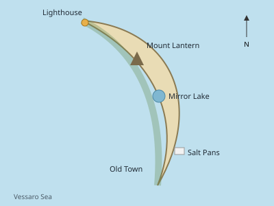
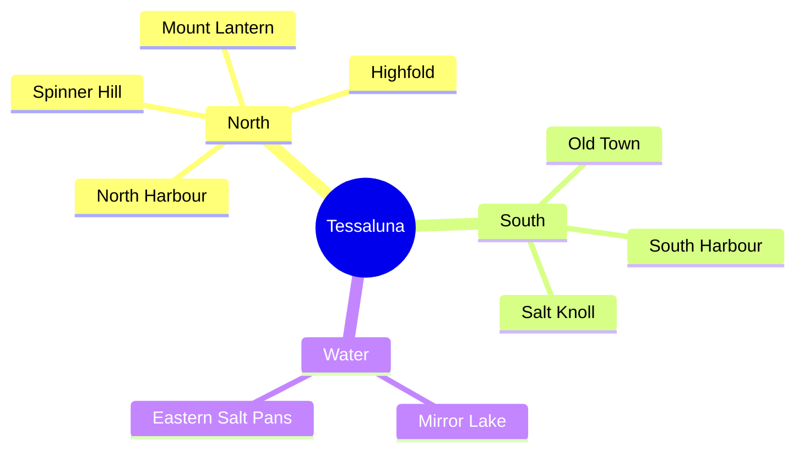

# Geography

- [Climate](climate.md)
- [Coasts and rocks](coasts%20and%20rocks.md)
- [The North](regions/north/README.md)
  - [Highfold](regions/north/villages/highfold.md)
  - [North Harbour](regions/north/villages/harbour.md)
- [The South](regions/south/README.md)
  - [Old Town](<regions/south/old town.md>)
  - [South Harbour](regions/south/harbour.md)
  - [The Harbour Café](regions/south/harbour%20café.md)

## Main heights

| Place | Region | Altitude (m) |
|:---|:---:|---:|
| Mount Lantern | North | 712 |
| Spinner Hill | North | 488 |
| Salt Knoll | South | 203 |
| Mirror Lake | border | 141 |
| Eastern Salt Pans | South | 2 |

