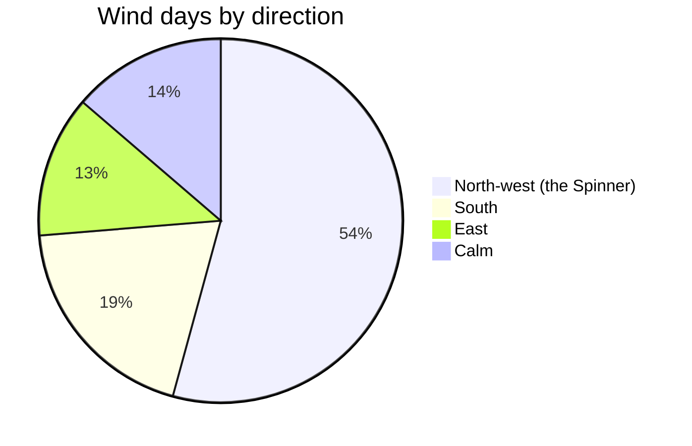

# Climate

Tessaluna has a mild, windy climate. The prevailing wind, which islanders call **the Spinner**,
blows from the north-west on about two hundred days a year and gives Spinner Hill its name.

## Average temperatures

| Month | Low °C | High °C | Rain mm |
|---|---:|---:|---:|
| January | 6 | 12 | 88 |
| April | 10 | 17 | 52 |
| July | 19 | 28 | 9 |
| October | 13 | 21 | 74 |

## Seasons

1. **Lantern season** (winter): short days and rough seas; [[lantern night]] falls in the middle of it.
2. **Salt season** (summer): the Eastern Salt Pans are harvested.
3. The short in-between seasons are simply called *the turn*.

> A saying from the island: *"When the Spinner falls silent, the ferry is never late."*

See also [[coasts and rocks]] and [[ferries]].
