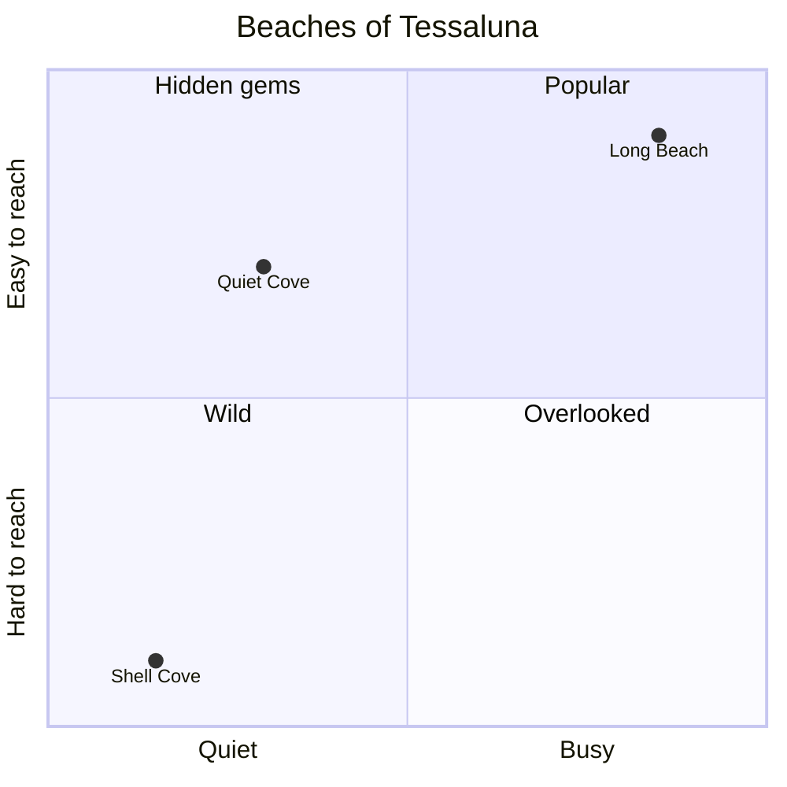

# Coasts and rocks

The western coast is high and rocky; the eastern coast is low and sandy and holds the Eastern
Salt Pans.

## Named rocks

- **The Hat**: off North Harbour, it looks like an upturned hat.
- **The Three Sisters**: three sea stacks west of [[lighthouse|the lighthouse]].
- **The Turtle**: only shows at low tide.

## Beaches

| Beach | Type | Access |
|---|---|---|
| Quiet Cove | sand | trail 2 |
| Shell Cove | pebbles | by boat only |
| Long Beach | sand | coast road |

To reach them on foot, see [[trails]].
