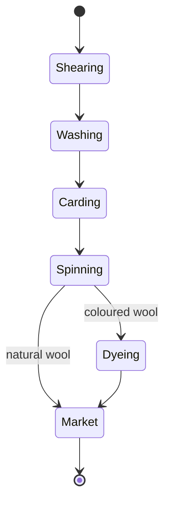

# Highfold

Highfold sits 390 metres up the side of Mount Lantern. According to the [[timeline]] it was the
first permanent settlement on the island.

## What to see

- **Millstone Square**, with two restored windmills.
- **The Hundred Steps**, a stair down to [North Harbour](harbour.md).
- The viewpoint, from which the whole crescent of the island is visible.

## People

About 600 people live here, mostly from sheep farming and wool.

