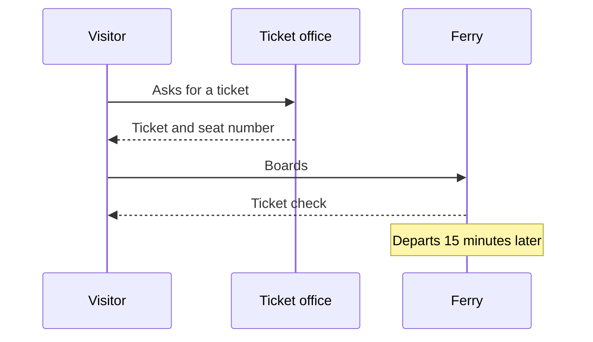

# South Harbour

South Harbour is the only port served by the scheduled [[ferries]]. The main pier is 240 metres
long with two berths.

## Services

- Ticket office (opens one hour before each departure)
- Left luggage
- Bicycle hire, see [[trails]]
- [[harbour café|The Harbour Café]], right on the pier

## The rules

Mooring rules are in the [harbour rules](../../../documents/harbour-rules.odt). A short version
for visitors is the [[documents/harbour.html|harbour quick guide]].

