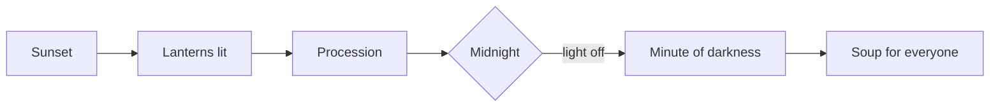

# Lantern Night

## The legend

The navigator Ilvessa, steering the first boat towards the island, lost her way in the fog. The
only points of light were thousands of [[silver snail|silver snails]] on the shore. She followed
their glow and came ashore: that was the Landing.

> An old islander tells it this way:
>
> > *"She did not find the island. The island lit a lamp for her."*

## The festival

Every year, on the longest night, islanders light a lantern in front of every door and carry it
in procession to [[lighthouse|the lighthouse]]. At midnight the lighthouse goes dark for one
minute and only the lanterns remain.

### Programme

1. Sunset: lanterns are lit in the [[old town|Old Town]]
2. Evening: procession along the coast road
3. Midnight: the minute of darkness
4. Night: [[recipes#spinner soup|Spinner soup]] for everyone

A flyer for this year's festival is in the [documents](../../documents/lantern-night-flyer.htm).
