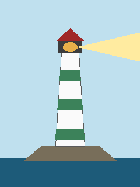
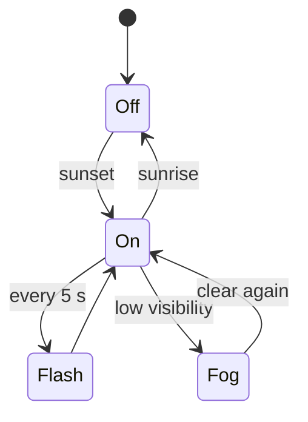

# The Long Point Lighthouse

The lighthouse was lit in **212 AL** on Long Point, the northern tip of the island. It is a white
tower with green bands, 31 metres tall.

## The keeper

For two centuries a keeper lived in the cottage at the foot of the tower and wrote down every
night in [[lighthouse-log|the log]]. Today the light is automatic and the cottage is a small
museum: see [[keeper's cottage]].

## The light

| Feature | Value |
|---|---|
| Colour | white |
| Character | two flashes every 10 seconds |
| Range | 18 nautical miles |

The lighthouse is at the heart of [[lantern night|Lantern Night]].
