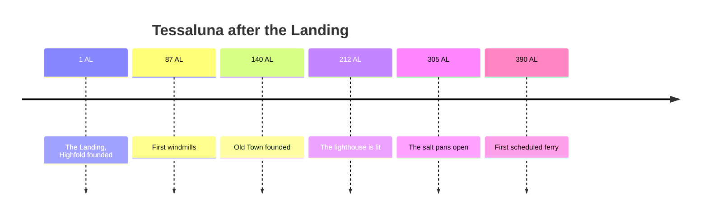

# Timeline

| Year | Event | Page |
|---:|---|---|
| 1 | The Landing[^landing] | [[highfold]] |
| 87 | Windmills on Spinner Hill | [[climate]] |
| 140 | Old Town is founded | [[old town]] |
| 212 | The lighthouse is lit | [[The Long Point Lighthouse]] |
| 305 | The salt pans open | [[copper crab]] |
| 390 | First scheduled ferry | [[ferries]] |

Everything before the Landing belongs to the [legends](legends/README.md).

[^landing]: The exact day is unknown; it is celebrated on the first day of spring.
