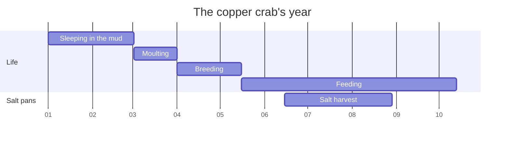

# Copper crab

A crab of the Eastern Salt Pans with a copper-coloured shell. It digs deep burrows in the mud
and only comes out at low tide.

## The crab's year

During the salt harvest the pans closest to the burrows stay closed.
