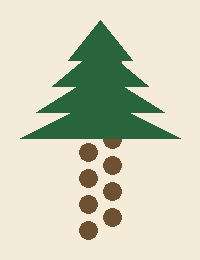

# Flora

## Lantern grass

A low grass with small yellow flowers that seem to hold on to the light for a few minutes after
sunset. It grows everywhere except on the salt pans and is the favourite food of the
[[silver snail]].

## Spiral pine

The trunk of this pine twists around itself to stand up to the Spinner. Spiral pine forests
cover most of [the North](../geography/regions/north/README.md).

## Salt lily

A white flower that grows only along the edges of the Eastern Salt Pans. It blooms at the end of
summer.

## Summary

| Plant | Height | Flowers | Where |
|:---|:---:|:---:|---:|
| Lantern grass | 10-20 cm | spring | everywhere |
| Spiral pine | up to 15 m | | North |
| Salt lily | 40 cm | late summer | Eastern Salt Pans |
| Sweet bramble | 1-2 m | summer | along the trails |

## Plant survey

- [x] Lantern grass counted
- [ ] Salt lilies counted
- [ ] Map of the spiral pine forests
