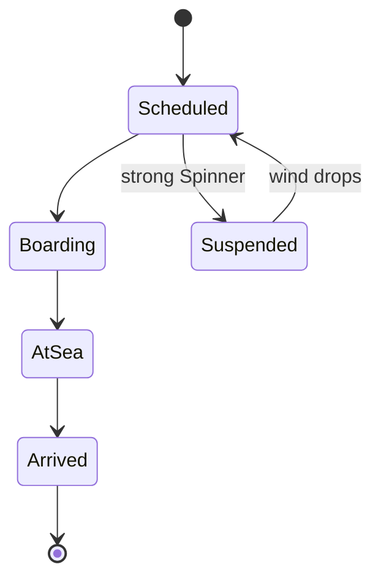
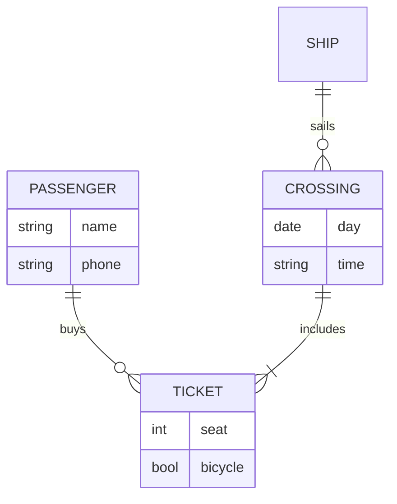

# Ferries

Two ferries link Tessaluna with the mainland at **Vessara Coast**. They leave from and arrive at
[[South Harbour]].

| Ship | Seats | Bicycles | Crossing |
|---|---:|:---:|---|
| *Vessaro Star* | 320 | yes | 1 h 40 min |
| *Little Gull* | 140 | no | 1 h 10 min |

The full timetable is in the spreadsheet [ferry-timetable.ods](ferry-timetable.ods).

## Summer

### Departures from South Harbour

07:00, 11:30, 16:00 and ~~21:00~~ 20:30 (the late crossing moved half an hour earlier this year).

## Winter

### Departures from South Harbour

07:00 and 16:00 only.

## The life of a crossing

## Booking

When the Spinner blows too hard, crossings are suspended: see [[climate]].
