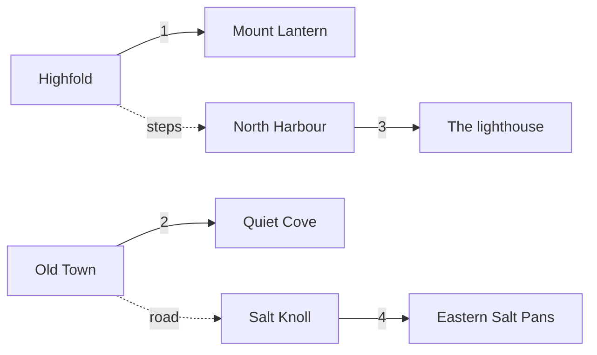

# Trails

| No. | From | To | Length | Difficulty |
|---:|---|---|---:|---|
| 1 | Highfold | Mount Lantern | 3.2 km | moderate |
| 2 | Old Town | Quiet Cove | 2.0 km | easy |
| 3 | North Harbour | The lighthouse | 4.5 km | moderate |
| 4 | Salt Knoll | Eastern Salt Pans | 1.8 km | easy |
| 5 | Round the island | | 41 km | hard |

## Tips

- Carry water: there is only one fountain along trail 5.
- The Spinner can be very strong on trail 3.
- Keep off the [[copper crab]] burrows on trail 4.

See also [[coasts and rocks]] and [[highfold|Highfold]].
