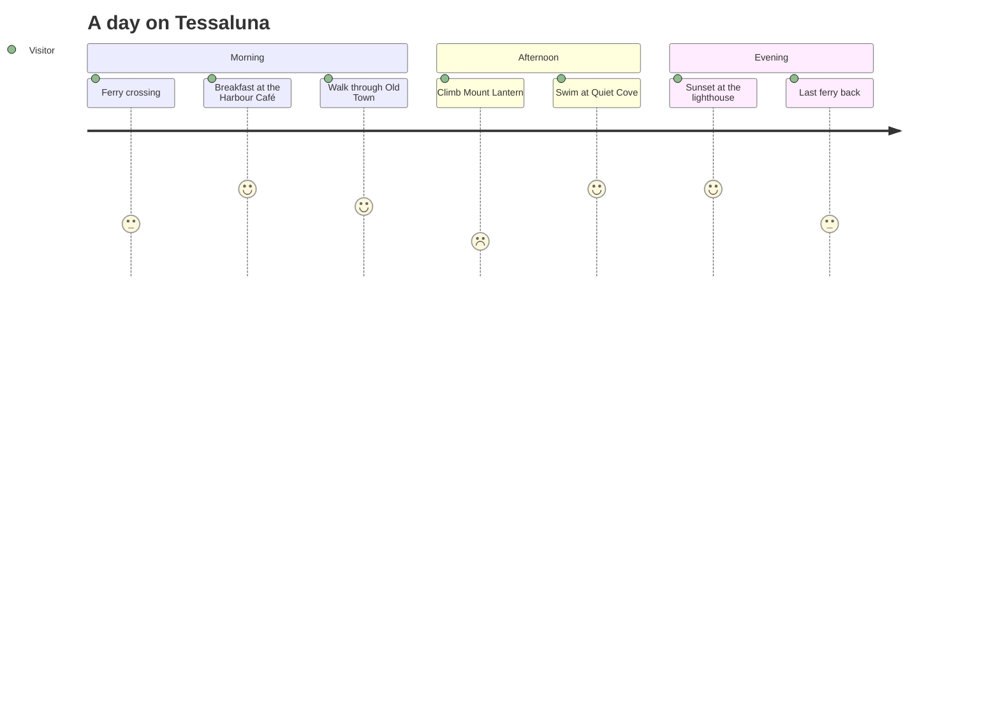

# A day on Tessaluna

A suggested day for a first visit, arriving on the morning ferry.

1. Take the 07:00 [[ferries|ferry]] and have breakfast at [[harbour café|the Harbour Café]].
2. Walk up to [[old town|Old Town]] and the Salt Loggia.
3. Hire a bicycle and follow [[trails#tips|the trail tips]].
4. End the day at [[lighthouse|the lighthouse]].
